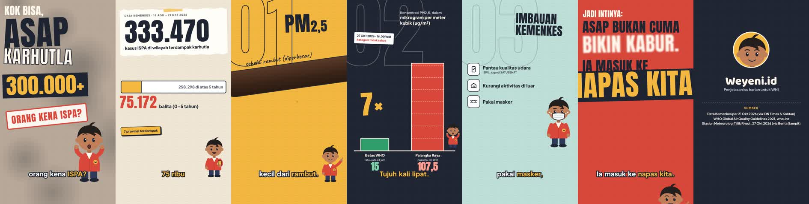

# Template Video Explainer 9:16

Template gratis untuk membuat video explainer animasi vertikal (Reels, Shorts, TikTok) **dari kode**: tokoh kartun, tipografi gaya kliping koran, transisi, subtitle yang sinkron per kata, dan efek suara. Hasilnya MP4 1080×1920, 30 fps, 45–60 detik.

Dibuat dan dipakai untuk channel **Weyeni.id**, lalu dibagikan supaya siapa pun bisa belajar membuat konten edukasi yang rapi dan bersumber.



Contoh di dalam paket: *"Kok bisa asap karhutla bikin 333 ribu orang kena ISPA?"* (7 adegan, sekitar 57 detik).

---

## Isi paket

| Folder / file | Isi |
|---|---|
| `template/animatic.html` | Semua adegan, animasi, transisi, subtitle, dan daftar efek suara. Fungsi `render(t)` menggambar frame pada detik ke-t. |
| `template/weyeni.js` | Generator SVG tokoh: `weyeni`, `nur`, `yohana`, `togar`, `lina`. Ekspresi `senyum/bicara/kaget/berpikir`, pose `santai/pegang-hp/kaget/berpikir/menunjuk`. |
| `template/words.js` | Waktu mulai dan selesai tiap kata narasi. Dipakai untuk sinkron animasi, subtitle, dan gerak mulut. |
| `template/naskah-contoh.txt` | Naskah contoh (749 karakter, sekitar 54 detik). |
| `template/frames.py` | Mengambil beberapa frame untuk dicek sebelum render penuh. |
| `template/render.py` | Merender video per adegan lalu menggabungkannya dengan narasi. |
| `template/sfx.py` | Membuat efek suara sintetis (bebas hak cipta) lalu mencampurnya dengan narasi. |
| `skill/produksi-video-explainer/SKILL.md` | Skill untuk Claude: alur lengkap dari riset topik sampai caption. |
| `contoh/` | Gambar pratinjau hasil. |

---

## Yang dibutuhkan

- **Python 3.10+** dan **Node.js 18+**
- **ffmpeg** (cek dengan `ffmpeg -version`)
- **Narasi MP3**, misalnya dari ElevenLabs (paket gratis cukup untuk belasan video per bulan) atau rekaman suaramu sendiri.

## Instalasi (sekali saja)

```bash
cd template
npm install                       # font: Anton, Plus Jakarta Sans, Baloo 2, Caveat
pip install -r requirements.txt   # playwright, numpy, scipy
python -m playwright install chromium
```

## Coba contoh dalam 3 langkah

```bash
cd template
python frames.py 4.5 26.3 36.4   # cek 3 frame → folder cek/
NAME=contoh python render.py      # render tanpa suara (±4 menit) → contoh-animatic.mp4
python sfx.py                     # efek suara saja → sfx.wav
```

Buka `animatic.html` di browser untuk melihat frame pertama. Di console, `render(20)` menampilkan detik ke-20.

---

## Membuat video baru

### 1. Tulis naskah
- Panjang **570–750 karakter** supaya durasinya 45–60 detik.
- Struktur: **hook** (pertanyaan atau angka, 0–3 detik) → **konteks + sumber** → **3 poin** → **"Jadi intinya…"** + pertanyaan untuk kolom komentar.
- Satu ide per kalimat. **Tulis angka dengan huruf** ("tiga ratus ribu") supaya pengisi suara AI membacanya dengan benar. Di layar, angkanya tetap ditampilkan sebagai digit.
- Pisahkan paragraf dengan baris kosong. Tiap paragraf akan menjadi satu adegan.

### 2. Buat narasi
Contoh dengan ElevenLabs: pilih suara asli penutur Indonesia dari Voice Library (suara bahasa Inggris akan terdengar berlogat), model `eleven_multilingual_v2`. Simpan hasilnya sebagai `narasi.mp3` di folder `template/`.

### 3. Ambil waktu per kata
Paling akurat lewat **transkripsi** yang menghasilkan waktu tiap kata (misalnya ElevenLabs Speech to Text / Scribe, Whisper, atau alat lain). Masukkan ke `words.js` dengan format berikut:

```js
window.WORDS=[[0,0.255],[0.302,0.824], ...]; // [mulai, selesai] dalam detik, satu per kata naskah
```

Jumlah elemen harus **sama dengan jumlah kata** di naskah (dipisah spasi).

### 4. Atur animasi di `animatic.html`
Semua waktu memakai **nomor urut kata**, bukan detik. Jadi kalau narasi direkam ulang, cukup ganti `words.js` dan semuanya ikut sinkron.

- `ws(i)` = detik saat kata ke-i mulai diucapkan (mulai dari 0). `we(i)` = detik saat kata itu selesai.
- `PARA` = nomor kata pertama tiap paragraf. Batas adegan dihitung otomatis di tengah jeda antarparagraf.
- `CAPW` = subtitle: `[kata_awal, kata_akhir, 'teks dengan <b>kata kunci</b>']`.
- Efek muncul: `pop(el,t,ws(40))`, `slam(...)`, `slideIn(...)`, `draw(...)`.
- Efek suara: `fx(ws(40),'impact',.8)`. Jenis yang tersedia: `pop, impact, stamp, tick, ding, chime, scratch, rise, swish, whoosh, blurwhoosh, zoom, boom, slices`.
- Tokoh: `drawChar(id, t, {pose:'menunjuk', ekspresi:'senyum', masker:false})`. Untuk tokoh lain, tambahkan `tokoh:'nur'`.

Tips desain dari pengalaman kami:
- Beri warna latar yang berbeda untuk tiap adegan, dan bedakan juga tata letaknya.
- Gunakan transisi yang berbeda dan beralasan di tiap pergantian adegan, misalnya zoom ke angka yang sedang dibahas atau lingkaran yang meluas dari sebuah elemen.
- Masukkan data nyata (tanggal, kutipan resmi singkat) dan akhiri dengan **kartu sumber**.
- Beri label "contoh" pada tampilan chat atau struk rekaan.

### 5. Cek, render, gabungkan

```bash
python frames.py 4.5 16 26 36 44 51        # cek frame terpadat dan titik transisi
NAME=judul python render.py narasi.mp3      # → judul-final.mp4
python sfx.py narasi.mp3                    # → mix.wav (narasi + efek)
ffmpeg -i judul-final.mp4 -i mix.wav -map 0:v -map 1:a -c:v copy -c:a aac -b:a 192k -shortest judul-final-sfx.mp4
```

---

## Mengganti merek dan tokoh

- **Nama channel dan tagline:** cari `Weyeni.id` dan `Penjelasan isu harian untuk WNI` di `animatic.html` (adegan terakhir).
- **Warna:** ubah variabel di `:root` (`--ink`, `--red`, `--yellow`, `--paper`, dan lainnya).
- **Tokoh:** ubah warna kulit, baju, dan celana di objek `LOOKS` dalam `weyeni.js`, atau tambahkan tokoh baru dengan pola yang sama. Tunjukkan keragaman lewat kulit, rambut, busana, dan kain, **bukan lewat logat atau lelucon suku**.

## Etika konten (sangat disarankan)

- Setiap angka dan klaim harus punya sumber yang **benar-benar kamu buka**, bukan sekadar cuplikan hasil pencarian. Cantumkan sumbernya di kartu sumber dan di caption.
- Angka yang hanya beredar di media dan tidak ada di sumber resmi sebaiknya jangan dipakai, atau beri tanda yang jelas.
- Jangan memakai logo merek pihak lain. Jangan menampilkan nama atau wajah warga biasa yang sedang viral.
- Hindari konten yang menjadikan anak sebagai objek viral, politik praktis yang memihak, dan tuduhan kriminal terhadap perorangan.

## Memakai skill dengan Claude

Folder `skill/produksi-video-explainer/` berisi `SKILL.md`. Kalau kamu memakai Claude dan fitur skill tersedia di akunmu, unggah file itu sebagai skill. Claude akan mengikuti alur yang sama: riset topik dengan sumber, naskah, suara, animasi, render, sampai caption. Ganti bagian **Identitas channel** di dalamnya dengan channel-mu sendiri.

## Lisensi

Kode template berlisensi **MIT** (lihat `LICENSE`): bebas dipakai, diubah, dan dibagikan, termasuk untuk komersial, asal mencantumkan pemberitahuan hak cipta. Font memakai SIL Open Font License. Suara narasi tidak disertakan.

Kalau template ini membantu, sebutkan **Weyeni.id** di deskripsi videomu. Terima kasih!
